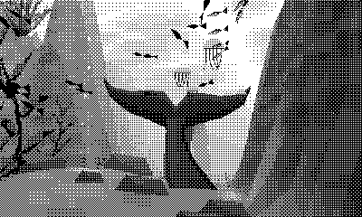
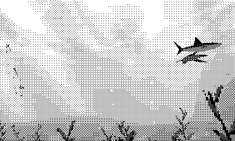
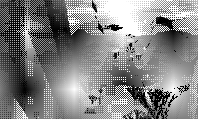

# Brineglass


A one-bit diving demo for **Playdate**, written in C. The tour opens on a sunken ship. Follow the camera through six dive sites, or press **A** mid-flight and swim straight into the scene.

**[Download Brineglass v0.7.3](https://github.com/meshchaninov/brineglass-playdate/releases/download/v0.7.3/Brineglass-0.7.3.pdx.zip)** · [Русский](README.ru.md) · [Watch the tour preview](docs/media/tour.gif)

## From the LCD

| Opening view in Playdate Simulator | Stone whale fluke, eight seconds into the flyby |
| --- | --- |
|  |  |

| Reef shark in the kelp channel | Squid above the coral shelf |
| --- | --- |
|  |  |

The opening screenshot comes from v0.7.1 running in Playdate Simulator. The other frames are native 400 × 240 exports from the v0.7.3 C renderer.

## Take a dive

On a Playdate, upload the release ZIP to your [Sideload page](https://play.date/account/sideload/), then download Brineglass on the console. On an Apple silicon Mac, unzip the archive and open **Brineglass.pdx** in Playdate Simulator. For another simulator platform, build from source.

A loop lasts 96 seconds. It leads from the **shipwreck** into the **kelp forest**, past the **stone whale fluke**, through **sponge canyon** and the **coral grotto**, and out to the **pillar grove**. Reef sharks patrol the wreck and kelp channel. Squid pulse through the canyon and grotto, and two silver schools wheel past the fluke and pillars. You can follow them in free swim alongside the rays, turtles and jellyfish.

| Control | On tour | In free swim |
| --- | --- | --- |
| D-pad | Right or down for the next view, left or up for the previous one | Up / down to swim, left / right to turn |
| A | Take control at the current camera position | Hold with up / down to rise or dive |
| Crank | | Tilt your view up or down |
| B | Open the dive map | Open the dive map |

On the map, choose a site with up / down and confirm with A. The system menu lets you resume the tour, toggle sound and show the FPS counter.

## Inside the renderer

[How Brineglass renders an underwater world in 33 ms (article in Russian)](docs/optimization.ru.md)

Brineglass draws each frame directly into the **400 × 240** one-bit framebuffer. The seabed advances from near to far. Each depth slice updates a horizon for every LCD column, so the next slice only fills newly visible rock. The same horizons clip kelp, coral branches and fish against the terrain. The Cortex-M7 compares four column heights per instruction using unsigned byte arithmetic.

The water projection samples wave and shaft intensities at the corners of 8 × 4 light patches. It interpolates the light across native scanlines and dithers eight LCD pixels into one byte. Triangle edges use fixed-point arithmetic. Sprites and facets are drawn from far to near, and the coral atlas skips transparent texels. The tour and free swim share this renderer.

| Physical Playdate, v0.7.3, sound enabled | Result |
| --- | ---: |
| Complete six-site tour | 2,910 frames in 95.997 s · **30.31 FPS** |
| Longest update, including controls, overlays and audio | 25 ms |
| Updates over 33 ms | 0 |

[The shipwreck approach before and after the seabed fix](docs/media/wreck-clearance.png) · [Timings for each site](docs/rendering.ru.md) · [Same camera in v0.5.5 and v0.6.0](docs/media/native-comparison.png)

## Build from source

Install the [Playdate SDK](https://play.date/dev/) and the Arm GNU toolchain with `arm-none-eabi-gcc` on your PATH. You also need GNU Make and a host C compiler. The release was built with SDK 3.0.2 on macOS.

```sh
git clone https://github.com/meshchaninov/brineglass-playdate.git
cd brineglass-playdate
make -j4
```

The Makefile reads `PLAYDATE_SDK_PATH` or the SDK configuration in `~/.Playdate/config`. It builds the coral atlas and produces **Brineglass.pdx** with both device code and a library for the host simulator.

## Credits

Brineglass adapts **Abyssal Garden** by **Maksymilian Dendura (Noniv)**. The dive sites, wreck, whale-tail landmark and underwater setting come from the original WebGPU world. The Playdate edition has its own C renderer, controls and camera tour. [Original project](https://github.com/Noniv/abyssal-garden) · [Adapted revision](https://github.com/Noniv/abyssal-garden/tree/a596354eff400d458bc2aeb9bdf5e0a9734b2bcf) · [MIT license](LICENSE)
