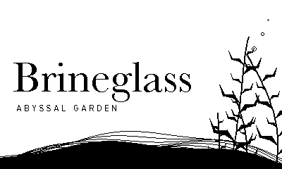
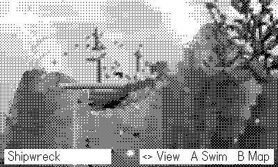

# Brineglass

A one-bit diving demo for **Playdate**, written in C. The tour opens on a sunken ship. Follow the camera through six dive sites, or press **A** mid-flight and swim straight into the scene.

<p> </p>

**[Download Brineglass v0.5.4](https://github.com/meshchaninov/brineglass-playdate/releases/download/v0.5.4/Brineglass-0.5.4.pdx.zip)** · [Русский](README.ru.md) · [Watch the tour preview](docs/media/tour.gif)

## Take a dive

On a Playdate, upload the release ZIP to your [Sideload page](https://play.date/account/sideload/), then download Brineglass on the console. On an Apple silicon Mac, unzip the archive and open **Brineglass.pdx** in Playdate Simulator. For another simulator platform, build from source.

A loop lasts 96 seconds. It leads from the **shipwreck** into the **kelp forest**, past the **stone whale fluke**, through **sponge canyon** and the **coral grotto**, and out to the **pillar grove**. Manta rays, fish, turtles and jellyfish move through the same world in free swim.

| Control | On tour | In free swim |
| --- | --- | --- |
| D-pad | Right or down for the next view, left or up for the previous one | Up / down to swim, left / right to turn |
| A | Take control at the current camera position | Hold with up / down to rise or dive |
| Crank | | Tilt your view up or down |
| B | Open the dive map | Open the dive map |

On the map, choose a site with up / down and confirm with A. The system menu lets you resume the tour, toggle sound and show the FPS counter.

## Inside the renderer

The console computes the camera, depth, water lighting and animals every frame. The seabed uses a heightfield marched from near to far. Kelp bends in the current. A build-time C tool grows branching corals, traces their surfaces from multiple directions and stores tone and depth so rocks can hide individual branches at runtime.

Water and terrain use a 100 × 60 grid. The foreground adapts between 100 × 60, 134 × 80 and 200 × 120. A final dithering pass reconstructs the 400 × 240 LCD image. The renderer can skip groups of landmark faces outside the view or behind terrain before projecting their vertices.

| v0.5.4 on physical Playdate, sound enabled | Result |
| --- | ---: |
| Complete six-site tour | 2,909 frames in 95.983 s · **30.31 FPS** |
| Shipwreck / whale fluke flybys | 30.35 / 30.29 FPS |
| Frames with render, UI and audio work over 33 ms | 7 of 2,909 |

These measurements come from one complete tour on firmware 3.1.2. The [renderer notes](docs/rendering.ru.md) include per-site resolutions, timings and comparison frames.

## Build from source

Install the [Playdate SDK](https://play.date/dev/) and the Arm GNU toolchain with `arm-none-eabi-gcc` on your PATH. You also need GNU Make and a host C compiler. The release was built with SDK 3.0.2 on macOS.

```sh
git clone https://github.com/meshchaninov/brineglass-playdate.git
cd brineglass-playdate
make -j4
```

The Makefile reads `PLAYDATE_SDK_PATH` or the SDK configuration in `~/.Playdate/config`. It builds the coral atlas and produces **Brineglass.pdx** with both device code and a library for the host simulator.

## Credits

Brineglass adapts **Abyssal Garden** by **Maksymilian Dendura (Noniv)**. The dive sites, wreck, whale-tail landmark and underwater setting come from the original WebGPU world. The Playdate edition has its own C renderer, controls and camera tour. [Original project](https://github.com/Noniv/abyssal-garden) · [Adapted revision](https://github.com/Noniv/abyssal-garden/tree/a596354eff400d458bc2aeb9bdf5e0a9734b2bcf) · [MIT license](LICENSE)
