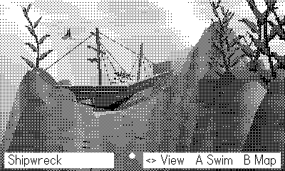
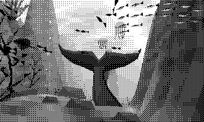
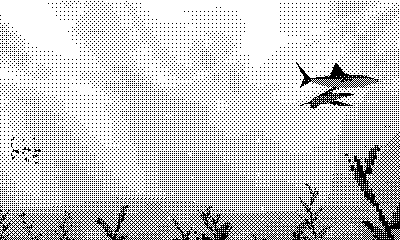
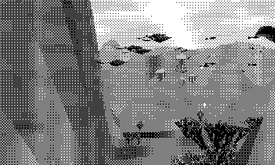

# Brineglass

Подводное демо для **Playdate**, написанное на C. В первом пролёте из зарослей показывается затонувший корабль. Камера обходит шесть мест за 96 секунд. Нажми **A** в любой момент, чтобы продолжить путь самостоятельно.

**[Скачать Brineglass 0.7.0](https://github.com/meshchaninov/brineglass-playdate/releases/download/v0.7.0/Brineglass-0.7.0.pdx.zip)** · [English](README.md) · [Пролёты в движении](docs/media/tour.gif)

## Кадры демо

| Старт в Playdate Simulator | Восьмая секунда пролёта у каменного китового хвоста |
| --- | --- |
|  |  |

| Рифовая акула в лесу ламинарии | Кальмары над коралловой полкой |
| --- | --- |
|  |  |

Стартовый кадр снят в Playdate Simulator на версии 0.7.0. Остальные кадры сохранены из C-рендера 0.7.0 в родном разрешении 400 × 240. Акул, кальмаров и косяки серебристых рыб можно встретить и в свободном плавании.

## Установка

Для консоли загрузи ZIP на [страницу Sideload](https://play.date/account/sideload/), затем скачай Brineglass на Playdate. На Mac с Apple silicon распакуй ZIP и открой **Brineglass.pdx** в Playdate Simulator. Для другой платформы симулятора собери проект из исходников.

## Управление

| Действие | На Playdate |
| --- | --- |
| Сменить пролёт | → или ↓ для следующего, ← или ↑ для предыдущего |
| Взять управление у камеры | A |
| Плыть и поворачивать | ↑ / ↓ и ← / → |
| Поднять или опустить взгляд | Кривошип |
| Всплыть или погрузиться | Удерживать A и нажать ↑ / ↓ |
| Открыть карту и выбрать место | B, затем ↑ / ↓ и A |
| Вернуться в демо, включить звук или счётчик FPS | Системное меню |

## Рендер и производительность

Рельеф, объекты и живность рисуются прямо в однобитный экранный буфер **400 × 240**. Границы скал и ветвей проходят по отдельным пикселям. Освещение воды рассчитывается по опорным точкам и интерполируется внутри участков 8 × 4 пикселя. И пролёты, и свободное плавание используют один рендерер.

На физической Playdate со звуком полный круг в версии 0.7.0 занял **95,998 с за 2910 кадров — 30,31 FPS**. Самый долгий вызов обновления игры с управлением, отрисовкой и звуком занял 28 мс. [Замеры шести пролётов](docs/rendering.ru.md) · [Китовый хвост до и после оптимизации](docs/media/native-comparison.png)

## Сборка

Нужны [Playdate SDK](https://play.date/dev/), GNU Make, компилятор C для компьютера и `arm-none-eabi-gcc` в PATH. Выполни `make -j4` в корне репозитория. SDK определяется через `PLAYDATE_SDK_PATH` или `~/.Playdate/config`. Результат сборки — **Brineglass.pdx**.

В основе порта — **Abyssal Garden** Максимилиана Дендуры (Noniv). [Оригинал](https://github.com/Noniv/abyssal-garden) · [Лицензия MIT](LICENSE)
