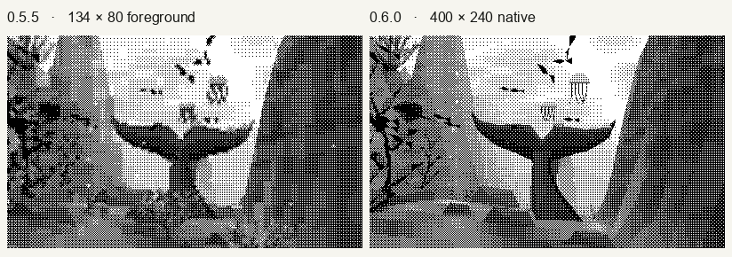
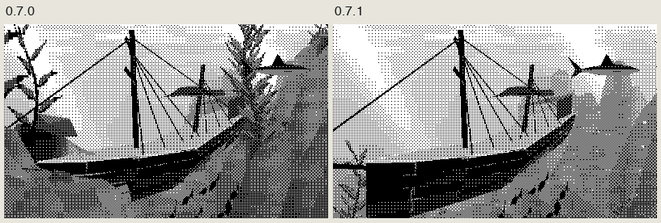

# Как Brineglass рисует подводный мир на Playdate за 33 мс

На восьмой секунде пролёта у каменного китового хвоста в кадре одновременно видны лопасти, тонкие щупальца медуз и освещённая вода. При низком разрешении первыми пропадали щупальца, а на кромке хвоста появлялись ступеньки. Для воды низкая частота выборки оказалась гораздо менее заметной. Из этого наблюдения вырос рендерер Brineglass. Границы объектов он рисует с точностью до одного пикселя экрана 400 × 240, а для света, глубины и движения выбирает свою частоту вычислений.



*Один ракурс в версиях 0.5.5 и 0.6.0. Разницу в разрешении проще всего увидеть по тонким кромкам на фоне воды.*

Весь маршрут занимает 96 секунд. В любой момент кнопка A отдаёт камеру игроку, и тот же C-код строит сцену из новой точки. Разберём, куда уходит время одного кадра в версии 0.7.1 и какую часть работы удалось вынести за его пределы. [Функция `render` и порядок проходов](../src/render.c#L1257)

## Один гребень скрывает целый склон

Дно хранится в сетке 161 × 161 с шагом два игровых метра. Движок проходит её поперечными срезами от камеры вдаль. Для каждого среза он берёт высоту на границах полос шириной восемь пикселей, интерполирует её между соседними точками карты и проецирует на экран. Внутри полосы верхний край склона вычисляется отдельно для каждого из восьми столбцов. Шаг по глубине постепенно растёт, а на 74 метрах проход заканчивается. За первые 12 метров туман ещё не ослабляет контраст, поэтому детали у камеры хорошо читаются. [Карта высот](../src/garden.h) · [Выбор срезов и проекция](../src/render.c#L119)

Представим один экранный столбец. Ближняя скала уже закрасила его от строки 150 до нижнего края. Если дальний гребень проецируется на строку 132, он добавит только строки 132–149. Если он проецируется на строку 170, ближняя скала закрывает его целиком. Достаточно запомнить высоту верхнего закрашенного пикселя. Движок сохраняет такой горизонт после каждого среза. Когда доходит очередь до рыбы, по её глубине можно выбрать подходящий горизонт и оставить видимой только часть рыбы над гребнем. Участки дна с навесом в такую карту не укладываются, поэтому каменные арки рисуются отдельными моделями. [Проход по рельефу](../src/render.c#L181) · [Отсечение строк объектов](../src/render.c#L251)

## Восемь пикселей помещаются в одну запись

У горизонта есть удобное свойство. Его высота лежит в пределах от 0 до 240 и помещается в байт. Для полосы из восьми столбцов движок хранит минимальную и максимальную высоту. Если строка проходит целиком выше или ниже края, результат известен сразу. На самом краю нужны восемь сравнений. Вот что вычисляет переносимый вариант функции `edge_bits` для симулятора.

```c
unsigned bits = 0;
for (int i = 0; i < 8; i++)
    bits = (bits << 1) | (y < edge[i]);
return bits;
```

На Cortex-M7 движок загружает четыре высоты в 32-разрядное слово. Инструкция `USUB8` вычитает из каждого байта значение `y + 1` и выставляет отдельный флаг для каждого результата без заёма. Следующая инструкция `SEL` по этим флагам выбирает заранее расставленные биты. Две такие пары обрабатывают восемь столбцов. Полученная маска совпадает по разметке с байтом экрана. Выражение `dst ^= (dst ^ pattern) & mask` меняет только видимые пиксели, сохраняя уже нарисованный ближний склон. [Обе реализации `edge_bits`](../src/render.c#L165)

У воды другая задача. Соседним пикселям обычно достаётся похожее освещение, особенно вдали от поверхности. Поэтому волны и световые лучи вычисляются в узлах сетки 8 × 4. На весь экран получается 51 × 61, то есть 3111 узлов. Между ними тон меняется от строки к строке. По горизонтальному градиенту, тону и номеру строки в узоре Байера 4 × 4 движок выбирает готовый байт из таблицы `rampInk`. Таблица занимает 25 КиБ. Она позволяет одной записью вывести восемь самостоятельных чёрно-белых точек и сохранить плавный переход света внутри участка. [Построение таблицы и отрисовка воды](../src/render.c#L37)

## Реймарчинг для кораллов окупился при сборке

У ветвистого коралла дорого обходятся просветы. Прямоугольник вокруг колонии может занять заметную долю экрана, хотя в большей его части видна вода. Сборочная утилита на C выращивает две формы колонии рекурсивным раздвоением ветвей. Затем она строит объёмное поле расстояний и проходит по нему лучами до первого попадания. Для каждой точки попадания сохраняются два байта — освещённость и глубина поверхности. В результате получаются 16 направлений обзора на трёх высотах для каждой формы. При размере 56 × 56 точек весь атлас занимает 588 КиБ. [Генератор ветвей и трассировка лучей](../tools/bake_coral.c) · [Формат атласа](../src/coral.h)

На консоли камера определяет нужный вид колонии. Рендерер берёт битовую маску занятых точек в строке и пересекает её с маской точек, которые после масштабирования занимают хотя бы один экранный пиксель. `__builtin_ctz(bits)` находит следующую ветвь, а `bits &= bits - 1` снимает обработанный бит. Пустые промежутки между ветвями пропускаются целиком. Сохранённая глубина выбирает горизонт рельефа для конкретного участка ветви. Благодаря этому камень может перекрыть нижнюю часть колонии, оставив верхние ветви видимыми. Цена такого представления видна при облёте вблизи — ракурс меняется дискретно. [Выбор ракурса и цикл по маске](../src/render.c#L703)

Для ламинарии важнее само движение. При запуске движок один раз рисует четыре формы растения и сохраняет в каждой строке непрозрачные отрезки. В кадре отрезки масштабируются, а их горизонтальное смещение растёт пропорционально квадрату высоты над основанием. Поэтому стебель удерживается на грунте, а верхние листья качаются в течении. У скал сходное разделение труда. Слои шума и трещины вычисляются при генерации мира в периодическом объёме 32 × 32 × 32. При движении камеры движок читает подготовленный тон поверхности и добавляет движущиеся блики. [Силуэт и изгиб ламинарии](../src/render.c#L742) · [Поле шероховатости камня](../src/stone.c) · [Освещение грунта](../src/world.c#L121)

## Когда проверка видимости стоит дороже рисунка

При загрузке корабль, китовый хвост и арки получают ограничивающие параллелепипеды для модели и для групп по 16 граней. Если за краем экрана или за рельефом оказалась вся модель, пропускается вся её геометрия. Если границы модели пересекают край кадра или ближнюю плоскость камеры, движок повторяет проверку для групп. Битовые маски оставшихся групп объединяются, и каждая нужная общая вершина проецируется один раз. Для прошедших отсечение треугольников границы строк вычисляются сложением с фиксированной точкой Q12. Команды попадают в 1024 корзины по приближённой обратной глубине и рисуются от дальних к ближним. При пересечении крупных полигонов порядок может дать видимую ошибку. [Маски вершин и отсечение групп](../src/render.c#L522) · [Корзины и растеризация треугольника](../src/render.c#L296)

Именно здесь замер на железе изменил решение. В версии 0.5.4 на одних и тех же 48 положениях камеры сравнили прежний рендерер и вариант с ранним отсечением групп. При 134 × 80 время у корабля снизилось с 31,05 до 29,46 мс. У китового хвоста при 200 × 120 оно **выросло** с 40,38 до 41,22 мс. Проверять видимость каждой доски оказалось дороже, чем нарисовать оставшиеся грани. Поэтому в текущем рендерере проверки сосредоточены на моделях и группах. Результаты этого A/B-теста относятся к прежнему разрешению. [Условия эксперимента и таблицы](rendering.ru.md#отсечение-геометрии-в-версии-054)

У корабля обнаружилась и геометрическая причина артефакта. Скала физически входила в обшивку, а при сближении камеры её край перескакивал между срезами рельефа. В 0.7.1 генератор дна получил систему координат корабля. Под килем остался песчаный гребень, а по обе стороны дно плавно опускается. Проверка сравнивает силуэт корабля с отсечением рельефом и при полностью открытом обзоре. В 0.7.0 скала скрывала до 6033 пикселей за кадр. После правки обе маски совпали во всех 480 положениях камеры. [Генерация дна](../src/world.c#L194) · [Тест силуэта](../tests/wreck_clearance.c)



## Куда ушёл запас до 33 мс

В первой версии с нативным рендером, 0.6.0, самый долгий вызов обновления на контрольном круге занял 25 мс. Часть запаса ушла на акул, кальмаров и два косяка по 28 рыб. Рыбы каждого косяка идут по общей орбите со сдвигом фазы. Направление корпуса задаёт касательная к орбите, а запаздывающий поворот боков создаёт волну бликов. Для видимой рыбки достаточно четырёх треугольников. Повторяющиеся колебания берутся из таблицы синуса с 1024 шагами и линейной интерполяцией. В замере 0.7.0 пик обновления достиг 28 мс. [Анимация и геометрия обитателей](../src/render.c#L1157) · [Замеры по версиям](rendering.ru.md)

На физической Playdate версия **0.7.1** со звуком показала **2910 кадров за 95,998 с, в среднем 30,31 FPS**. У корабля обновление заняло в среднем 18,4 мс с пиком 22 мс. Самым тяжёлым на этом круге оказался китовый хвост — 21,5 мс в среднем и 26 мс в пике. У интервала между кадрами свой счётчик. Его 95-й процентиль составил 33 мс в каждом пролёте, максимум за круг — 35 мс. Так можно увидеть задержку показа, даже когда управление, рендер, подписи и вызовы звука уложились в бюджет. [Шесть пролётов на консоли](rendering.ru.md#корабль-и-скала-в-071) · [Код измерения](../src/main.c#L22)

Чтобы повторить проверку, соберите проект командой `make` и запустите `make check-wreck` для проверки силуэта на компьютере. Для замера времени запустите сборку на Playdate с включённым звуком, оставьте деморежим на полный круг и соберите шесть строк `device` из консоли SDK. Частота равна суммарному числу кадров, умноженному на 1000 и делённому на суммарное время в миллисекундах. Для оценки запаса вычтите `peak work` из бюджета кадра. У китового хвоста при целевых 30 Гц осталось примерно 7,3 мс (1000 / 30 − 26). [Инструкция по сборке](../README.ru.md#сборка)
