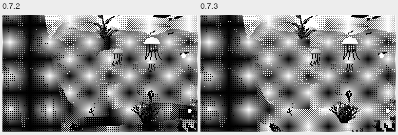
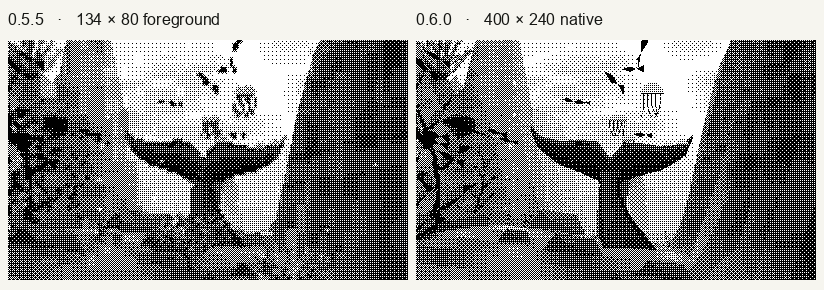

# Brineglass для Playdate

Демо для Playdate на C. Камера сама проходит шесть маршрутов за 96 секунд. Каждый пролёт длится 16 секунд и охватывает от 31 до 53 игровых метров. Стрелки сразу переключают вид и запускают выбранный пролёт с начала. Кнопка A даёт свободно плавать с текущего положения камеры. Через системное меню можно вернуться к показу.

## Управление

| Действие | Playdate |
| --- | --- |
| Следующий / предыдущий вид в демо | → или ↓ / ← или ↑ |
| Перейти из демо к свободному плаванию | A |
| Плыть вперёд или назад в свободном режиме | ↑ / ↓ |
| Повернуть | ← / → |
| Поднять или опустить взгляд | Повернуть кривошип |
| Всплыть или погрузиться | Удерживать A и нажать ↑ / ↓ |
| Открыть или закрыть карту | B |
| Выбрать пролёт или точку свободного погружения на карте | ↑ / ↓, затем A |
| Включить демо, звук или счётчик FPS | Системное меню |

В симуляторе стрелки соответствуют крестовине, клавиша S — кнопке A, клавиша A — кнопке B. Для управления взглядом мышью сними флажок Docked и поверни экранный кривошип.

## Сборка

В каталоге проекта запусти `make` с установленными Playdate SDK и GNU Arm Embedded Toolchain. Makefile берёт SDK из PLAYDATE_SDK_PATH или из ~/.Playdate/config. Готовый Brineglass.pdx содержит программу для консоли и библиотеку симулятора для той системы, на которой была выполнена сборка.

## Песок и тени в Coral Grotto в 0.7.3

Когда группы кораллов стояли близко, их тени складывались. Тёмный участок попадал сразу на целый срез рельефа. В движении под растениями были видны чёрные полосы. Кроме того, часть прореженных растений оставляла тень. Теперь генератор сначала выбирает растения, затем запекает узкую тень у основания каждого. Там, где тени перекрываются, учитывается сильнейшая из них. На пологом дне грота появился светлый песок, на крутых стенах сохранилась фактура породы. Всё освещение грунта от этого изменения рассчитывается при загрузке.

На компьютере сравнили рельеф в 480 положениях камеры. Силуэт дна на каждом срезе глубины совпал. Для проверки полос отдельно отрисовали дно без живности и растений. В нижней правой части кадра (256 × 56 пикселей) измерили долю блоков 8 × 4 с четырьмя или меньшим числом светлых пикселей. За пролёт она снизилась с 9,3 % до 0 %. Команда `make check-grotto` проверяет длинные горизонтальные цепочки таких блоков на восьмой, одиннадцатой и четырнадцатой секундах.

На физической Playdate со звуком при 400 × 240 полный круг дал **2910 кадров за 95,997 с (30,31 FPS)**. Пик работы в Coral Grotto составил 22 мс, во всём туре — 25 мс.

| Пролёт | Кадры | FPS | Средняя работа, мс | Пик работы, мс | Интервал между кадрами, P95 / максимум, мс |
| --- | ---: | ---: | ---: | ---: | ---: |
| Shipwreck | 485 | 30,37 | 18,6 | 22 | 33 / 34 |
| Kelp forest | 485 | 30,30 | 14,1 | 18 | 33 / 34 |
| Whale fluke | 485 | 30,30 | 21,7 | 25 | 33 / 34 |
| Sponge canyon | 485 | 30,30 | 19,7 | 23 | 33 / 34 |
| Coral grotto | 485 | 30,30 | 16,8 | 22 | 33 / 34 |
| Pillar grove | 485 | 30,30 | 14,7 | 18 | 33 / 34 |

## Как рыбы огибают дно в 0.7.2

В прежней версии косяки под скатами могли проплыть сквозь склон, а у других косяков проверка высоты просто скрывала рыб возле грунта. Теперь при загрузке вокруг гребней строится карта безопасных подходов. Она использует 51 КиБ памяти. Квадратичное сглаживание высоты даёт непрерывный наклон траектории, по которому рыба поднимает нос перед склоном. В открытой воде она возвращается к своей глубине. У скатов запас высоты зависит от размаха крыльев, а три орбиты проходят дальше от мелководья.

Команда `make check-swimmers` проверяет вершины и центры треугольников живности до отсечения грунтом. При выборке 30 раз в секунду на каждом из шести пролётов проверка прошла все 2880 кадров. На версии 0.7.1 она обнаруживает пересечение в пролёте у китового хвоста на 0,13 с.

На физической Playdate при 400 × 240 и включённом звуке полный круг занял 95,998 с. За это время игра показала 2910 кадров (30,31 FPS). Самое долгое обновление заняло 25 мс.

| Пролёт | Кадры | FPS | Средняя работа, мс | Пик работы, мс | Интервал между кадрами, P95 / максимум, мс |
| --- | ---: | ---: | ---: | ---: | ---: |
| Shipwreck | 485 | 30,37 | 18,6 | 22 | 33 / 34 |
| Kelp forest | 485 | 30,30 | 14,1 | 19 | 33 / 34 |
| Whale fluke | 485 | 30,30 | 21,8 | 25 | 33 / 34 |
| Sponge canyon | 485 | 30,30 | 19,7 | 23 | 33 / 34 |
| Coral grotto | 485 | 30,30 | 16,8 | 22 | 33 / 34 |
| Pillar grove | 485 | 30,30 | 14,7 | 18 | 33 / 34 |

## Корабль и скала в 0.7.1

Скала поднималась сквозь обшивку у носа и кормы. При движении камеры менялись срезы глубины, и край скалы перескакивал по борту. Генератор теперь использует систему координат корабля при формировании дна. Под килем проходит песчаный гребень, по сторонам дно плавно уходит вниз. При размещении камней и растений генератор учитывает ширину корпуса. [Одиннадцатая секунда пролёта в обеих версиях](media/wreck-clearance.png)

Команда `make check-wreck` проверяет 480 положений камеры за 16 секунд. Для каждого положения тест сравнивает силуэт корабля с отсечением рельефом и с полностью открытым обзором. В версии 0.7.0 рельеф закрывал до 6033 пикселей силуэта за кадр. В версии 0.7.1 маски совпали на всех 480 кадрах.

Полный круг на физической Playdate со звуком при 400 × 240 дал **2910 кадров за 95,998 с (30,31 FPS)**. Игра уложилась в 33 мс на обновление во всех шести пролётах.

| Пролёт | Кадры | FPS | Средняя работа, мс | Пик работы, мс | Интервал между кадрами, P95 / максимум, мс |
| --- | ---: | ---: | ---: | ---: | ---: |
| Shipwreck | 485 | 30,37 | 18,4 | 22 | 33 / 34 |
| Kelp forest | 485 | 30,30 | 13,6 | 18 | 33 / 34 |
| Whale fluke | 485 | 30,30 | 21,5 | 26 | 33 / 34 |
| Sponge canyon | 485 | 30,30 | 19,9 | 25 | 33 / 34 |
| Coral grotto | 485 | 30,30 | 16,9 | 24 | 33 / 34 |
| Pillar grove | 485 | 30,30 | 14,4 | 18 | 33 / 35 |

## Морские обитатели в 0.7.0

Две рифовые акулы патрулируют корабль и лес ламинарии. У каждой акулы поперечная волна изгиба нарастает от головы к хвосту. Две группы по пять кальмаров движутся мантией вперёд короткими рывками, пульсируя мантией. Ещё два косяка по 28 рыб огибают каменный хвост и колонны. Запаздывающий поворот соседних рыб даёт волну светлых бликов. Все шесть мест доступны и в свободном плавании.

Звук включён. Один полный круг на физической Playdate дал **2910 кадров за 95,998 с, в среднем 30,31 FPS** при 400 × 240. Пик обновления игры составил 28 мс. Кадров с работой дольше 33 мс — 0.

| Пролёт | Кадры | FPS | Средняя работа, мс | Пик работы, мс | Интервал между кадрами, P95 / максимум, мс |
| --- | ---: | ---: | ---: | ---: | ---: |
| Shipwreck | 485 | 30,37 | 21,8 | 26 | 34 / 34 |
| Kelp forest | 485 | 30,30 | 14,2 | 19 | 34 / 34 |
| Whale fluke | 485 | 30,30 | 22,2 | 28 | 34 / 34 |
| Sponge canyon | 485 | 30,30 | 20,4 | 26 | 34 / 34 |
| Coral grotto | 485 | 30,30 | 17,4 | 24 | 34 / 34 |
| Pillar grove | 485 | 30,30 | 14,9 | 18 | 34 / 34 |

## Нативный рендер в 0.6.0

Полный круг на физической Playdate с включённым звуком дал **2910 кадров за 95,999 с, в среднем 30,31 FPS**. Все шесть сцен используют нативное разрешение 400 × 240. Замер начинается при запуске игры и охватывает смены видов, подсказки управления, анимацию и звук.

| Пролёт | Кадры | FPS | Среднее время работы, мс | Пик работы, мс | Интервал между кадрами, P95 / максимум, мс |
| --- | ---: | ---: | ---: | ---: | ---: |
| Shipwreck | 485 | 30,37 | 20,5 | 25 | 33 / 34 |
| Kelp forest | 485 | 30,30 | 12,8 | 17 | 33 / 34 |
| Whale fluke | 485 | 30,30 | 20,8 | 25 | 33 / 34 |
| Sponge canyon | 485 | 30,30 | 18,9 | 23 | 33 / 34 |
| Coral grotto | 485 | 30,30 | 16,0 | 23 | 33 / 34 |
| Pillar grove | 485 | 30,30 | 12,9 | 17 | 33 / 34 |

Рендер идёт от ближнего среза дна к дальнему. Движок берёт высоту на карте и проецирует её на границах восьмипиксельных полос. Между ними он вычисляет край в каждом столбце LCD и рисует только открывшуюся часть склона. Хребет на известной глубине заодно даёт маску перекрытия для переднего плана. На Cortex-M7 инструкции `USUB8` и `SEL` сравнивают по четыре высоты одновременно. В симуляторе ту же маску строит обычный C-код.

Вода получает свет по углам участков 8 × 4. Внутри участка яркость интерполируется по строкам, а таблица градиентов даёт восемь пороговых решений для восьми пикселей. Геометрия использует рёбра с фиксированной точкой. Поверхности рисуются от дальних к ближним с сортировкой по приближённой глубине. В местах пересечения крупных полигонов такой порядок может отличаться от попиксельного Z-буфера.

Кораллы сохраняют текстуру и глубину из атласа. Битовая маска каждой строки позволяет пропустить прозрачные участки. В зарослях стало больше промежутков, у китового хвоста и дальних черепах меньше внутренних граней, а колокол и щупальца медузы рисуются строками. Сравнение показывает одну и ту же камеру на восьмой секунде пролёта у хвоста.

## История рендера до 0.6.0

Камера движется по шести кривым с отдельными целями для взгляда. Скорость выравнивается по пройденному расстоянию. Вдоль маршрутов расположены заросли, камни и колонии губок. Над ними кружат косяки рыб, проплывают манты и черепахи, пульсируют медузы. Те же обитатели встречаются при свободном плавании.

Координаты основных скальных массивов, арки, районы растительности, композиции точек обзора и маршруты скатов основаны на исходном мире. Корабль собран из шпангоутов, рядов обшивки и мачт. Дно упрощено до карты высот, арки сделаны отдельными объёмными моделями. Навесы и вырезанные в породе тоннели исходной сцены опущены.

Два вида кораллов растут по рекурсивному правилу ветвления. Генератор на C объединяет сужающиеся ветви в поле расстояний и проходит лучами по нему при сборке. Для каждой колонии он сохраняет 16 направлений обзора на трёх уровнях высоты. В ячейке изображения размером 56 × 56 хранятся тон и глубина первого пересечения луча с поверхностью. В игре глубина позволяет камню закрыть часть ветвей. Один атлас для всех колоний занимает 588 КиБ.

Для шероховатости скал используется периодическое трёхмерное поле размером 32 × 32 × 32. Крупные уступы входят в карту высот, а близкая поверхность получает мелкие сколы и трещины. Фактура привязана к координатам мира. Вода, каустика, взвесь и подводные обитатели анимируются в том же рендерере.

Автоматический показ и свободное плавание вызывают один рендерер на C. Маршрут задаёт текущее положение камеры и точку, куда она смотрит. Геометрия, глубина, позы животных, вода и изображение на экране рассчитываются на консоли каждый кадр. Кнопка A передаёт управление в текущей позиции. В пакет игры входят нативная программа, библиотека симулятора, метаданные, оформление меню Playdate и лицензия.

Дно рисуется по карте высот полосами от камеры к горизонту. Каждый новый срез добавляет только участки, которые видны над предыдущими. Текстура породы привязана к координатам мира и высоте поверхности. Буфер глубины скрывает растения за скалами. Корабль, китовый хвост и арки используют общие вершины, каждая из которых проецируется один раз за кадр. Ламинария изгибается по строкам силуэта, дальние рыбы ориентируются по проекции направления движения. Подробнее о подходе к рельефу на такой консоли можно прочитать в [эксперименте с Voxel Space на Playdate](https://devforum.play.date/t/3d-landscape-proof-of-concept-download-and-source-now-included/11359).

В версии 0.5.1 лучи выбирают высоту непрерывно внутри каждой двухметровой ячейки. На крутом силуэте между двумя основными лучами проходит дополнительный луч. Он проверяет центры и половинные шаги около найденного гребня. Верхний край скалы восстанавливается на сетке LCD с проверкой глубины переднего плана. Для остальной картинки движок оценивает яркость и её наклон по соседям, а затем выбирает готовый узор из чёрных и белых точек. Все расчёты зависят от текущей камеры.

При проверке версии 0.5.1 на 24 положениях камеры сравнили силуэт дна с эталонной трассировкой отдельным лучом в каждом из 400 столбцов, с шагом по глубине 0,07 м. В расчёт вошли 6 791 видимый столбец на каждом уровне детализации. При 100 × 60 средняя абсолютная ошибка высоты контура уменьшилась с 5,20 до 2,09 пикселя LCD, при 134 × 80 — с 4,30 до 1,97, при 200 × 120 — с 3,20 до 1,62. На изображении [skyline-comparison.png](media/skyline-comparison.png) показана одна и та же точка маршрута при 100 × 60.

В версии 0.5.2 первые 12 игровых метров сохраняют исходную контрастность материалов. Дальше тон плавно приближается к яркости воды в этой части экрана. Мелкая живность и растения растворяются в фоне примерно с 30 до 39 м. Дальность расчёта дна сократилась со 121 до 78 м, а за 30 м шаг между срезами увеличивается. Верхний контур скал по-прежнему уточняется в координатах LCD.

В версии 0.5.3 вода и рельеф рассчитываются на сетке 100 × 60 при любом разрешении переднего плана. Каждый луч рельефа покрывает два соседних столбца этой сетки. Движок хранит по одному тону и значению глубины на луч и сразу заполняет ими нужное количество ячеек переднего плана. Это устраняет копирование целого буфера глубины для коррекции контура. Таблицы дизеринга сгруппированы по наклону яркости, тону и положению пикселя в узоре. Вывод каждого из трёх размеров использует свой цикл упаковки в экран 400 × 240.

При одинаковой сетке фона сверка с прежним алгоритмом разворачивания фона и дизеринга показала полное совпадение изображения в 108 кадрах на шести маршрутах и трёх уровнях детализации. В 0.5.2 верхний уровень рассчитывал фон в 134 × 80, в 0.5.3 освободившееся время отведено под передний план. На [resolution-comparison.png](media/resolution-comparison.png) показана одна точка в лесу ламинарии при принудительном выборе уровня. Слева объекты рассчитаны в 134 × 80 в версии 0.5.2, справа — в 200 × 120 в версии 0.5.3.

Целевая частота — 30 Гц. При смене вида контроллер начинает с лёгкого кадра и может повысить детализацию через 18 кадров. В версии 0.5.4 переход с 200 × 120 вниз происходит при затратах от 35 мс или среднем выше 30 мс. Для перехода с 134 × 80 на 100 × 60 пороги составляют 36 и 31,4 мс соответственно. Контроллер проверяет среднее после четырёх кадров на текущем уровне. На [visibility-comparison.png](media/visibility-comparison.png) показаны две точки маршрута. Сверху — коралловый грот, снизу — каньон губок. Слева обе сцены показаны в версии 0.5.1 при 100 × 60, справа — при той же камере и фазе анимации в версии 0.5.2 с сеткой 134 × 80 для объектов и 100 × 60 для фона.

## Производительность на Playdate

### Отсечение геометрии в версии 0.5.4

При запуске движок вычисляет ограничивающие параллелепипеды статических моделей и групп по 16 граней. В кадре он проверяет, попадает ли параллелепипед в поле зрения и закрывают ли все его экранные плитки более близкие участки дна. Для оставшихся групп проецируются только нужные вершины. У широкой части китового хвоста дополнительно отбрасываются уверенно отвёрнутые внутренние грани лопастей. Наконечники и кромки остаются двусторонними. При входе камеры в область хвоста проверка ориентации отключается. Отверстия в обшивке и просветы такелажа обрабатываются обычным буфером глубины.

В аппаратном A/B-тесте сравнивались одинаковые 48 положений камеры на каждый пролёт и уровень детализации. Порядок старого и нового рендера чередовался. При 134 × 80 время рендера у корабля снизилось с 31,05 до 29,46 мс, у хвоста — с 30,29 до 29,93 мс. При 200 × 120 корабль ускорился с 41,99 до 41,08 мс, а у хвоста затраты выросли с 40,38 до 41,22 мс. В этих 192 сравнениях на консоли все видимые строки LCD совпали с версией 0.5.3. На компьютере также совпали 2592 кадра при пролётах, облёте с разных сторон и вблизи обеих моделей.

В обычном деморежиме со звуком физическая Playdate показала 2909 кадров за 95,983 с (30,31 FPS). В каждом пролёте 95-й процентиль интервала между кадрами составил 33 мс. Семь кадров из полного круга потребовали больше 33 мс работы.

| Пролёт | Кадры | Длительность, мс | Пик работы, мс | Кадров 200×120 / 134×80 / 100×60 |
| --- | ---: | ---: | ---: | ---: |
| Shipwreck | 485 | 15982 | 35 | 0 / 235 / 250 |
| Kelp forest | 485 | 16005 | 32 | 229 / 238 / 18 |
| Whale fluke | 485 | 16011 | 34 | 0 / 320 / 165 |
| Sponge canyon | 484 | 15974 | 35 | 30 / 371 / 83 |
| Coral grotto | 485 | 16005 | 33 | 25 / 442 / 18 |
| Pillar grove | 485 | 16006 | 32 | 376 / 91 / 18 |

В замере 0.5.3 у корабля было 32 кадра при 134 × 80, у хвоста — 116. На повторном круге непосредственно перед экспериментом у 0.5.3 получилось 48 и 119 соответственно. Изменение долей в 0.5.4 включает как выигрыш от отсечения, так и новую настройку порога среднего уровня. По 100 положениям камеры у корабля основные сэкономленные группы принадлежат находящимся за рельефом или вне поля зрения другим моделям. Отдельная проверка глубины каждой доски оказалась дороже. На изображении [landmark-resolution.png](media/landmark-resolution.png) слева показаны объекты при фиксированных 100 × 60, справа — в тех же ракурсах при 134 × 80.

### Предыдущий замер

Версия 0.5.3, физическая Playdate с прошивкой 3.1.2, звук включён. Полный круг занял 95,996 с, консоль отрисовала 2909 кадров (30,30 FPS). В каждом пролёте 95-й процентиль интервала составил 33 мс. Работы дольше 33 мс потребовали 14 кадров против 44 в версии 0.5.2. Пик затрат снизился с 44 до 37 мс.

| Пролёт | Кадры | Длительность, мс | Пик работы, мс | Кадров 200×120 / 134×80 / 100×60 |
| --- | ---: | ---: | ---: | ---: |
| Shipwreck | 485 | 15991 | 37 | 0 / 32 / 453 |
| Kelp forest | 485 | 16005 | 32 | 260 / 207 / 18 |
| Whale fluke | 484 | 15979 | 35 | 0 / 116 / 368 |
| Sponge canyon | 485 | 16010 | 36 | 0 / 368 / 117 |
| Coral grotto | 485 | 16006 | 32 | 30 / 437 / 18 |
| Pillar grove | 485 | 16005 | 31 | 328 / 139 / 18 |

За этот круг передний план получил 134 × 80 или выше в 1917 кадрах (65,9 %). Из них 618 кадров отрисованы в 200 × 120. Для сравнения, в версии 0.5.2 тот же маршрут дал 1067 из 2905 кадров (36,7 %) в 134 × 80 и ни одного в 200 × 120.

Для сравнения фиксированных уровней взяли по 12 одинаковых положений камеры на каждом из шести маршрутов. Среднее время рендера при 134 × 80 снизилось с 31,63 до 25,34 мс, при 200 × 120 — с 47,76 до 35,95 мс. В исходном профиле таймер вызывался между этапами, в финальном — вокруг всего рендера. В шести тестовых маршрутах свободного плавания итоговая сборка показала 30,27 FPS за 714 интервалов, максимальный интервал — 39 мс.

Оригинал — Maksymilian Dendura (Noniv), лицензия MIT. Адаптация основана на ревизии a596354eff400d458bc2aeb9bdf5e0a9734b2bcf. Текст лицензии находится в Source/LICENSE.txt и включён в пакет игры. [Репозиторий оригинала](https://github.com/Noniv/abyssal-garden)
